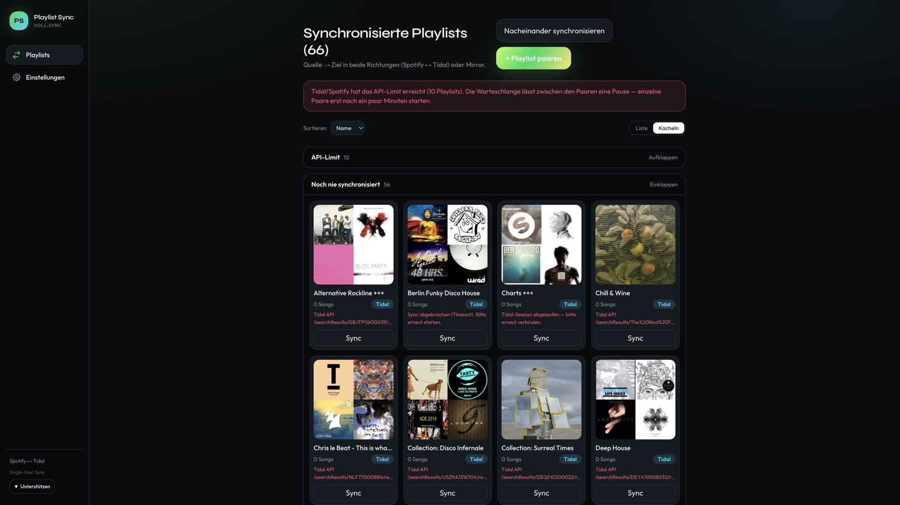

# Playlist Sync

[](LICENSE)
[](https://github.com/ChrisEdS/playlist-sync/releases)
[](https://github.com/sponsors/ChrisEdS)

Single-user playlist sync for **Spotify ↔ Tidal** and, optionally, **Spotify 1 ↔ Spotify 2**. Self-host it on **Vercel** + **Neon**. The interface is German.

One deploy is one operator. This is not a multi-tenant service, and it is not affiliated with Spotify, Tidal, or FreeYourMusic.



## What it does

| Direction | What happens |
| --- | --- |
| **Quelle → Ziel** | Copies missing tracks from the source playlist into the destination. The source is never changed. The destination may start empty. Nothing is deleted. |
| **Mirror** | Both sides converge, including removals. More than **20** removals at once are held until you confirm them on the pair page. |

Directions you can pair:

- Spotify → Tidal, or Tidal → Spotify
- Spotify 1 → Spotify 2, or Spotify 2 → Spotify 1
- Mirror on either kind of pair

Around that:

- Link playlists that already exist on both sides (including a batch match by name), or create the destination playlist
- Preview a run before it writes, then watch a live progress bar
- Rematch tracks the catalog search could not place, into the current destination
- One sync at a time, with a short pause between pairs and a longer pause after a rate limit (`429`)
- Optional daily run at **04:00 UTC** for pairs that have **Täglicher Cron** turned on
- Export a pair as M3U8 or CSV
- Store Spotify and Tidal client credentials in **Einstellungen** (encrypted in the database), or fall back to environment variables
- Optional second Spotify account on the same Spotify developer app
- Optional app PIN, or skip it with `DISABLE_APP_PIN=1` when Vercel Deployment Protection already covers access
- **Unterstützen** in the sidebar and in settings links to [GitHub Sponsors](https://github.com/sponsors/ChrisEdS). Forks can point that link elsewhere with `NEXT_PUBLIC_DONATION_URL`

Deleting a pair in the app does not delete the playlists on Spotify or Tidal.

## How matching works

1. Same ISRC, when both sides have one.
2. Otherwise title and artist, after stripping remaster tags, “feat.”, and similar noise. Durations that differ by more than about **4 seconds** are rejected, so a live or piano version is less likely to be treated as the same recording.
3. Tracks that still do not match stay on the pair page for a manual rematch.

Two guards sit on top of that:

- **Empty destination is allowed** on a first copy. A brand-new Tidal or Spotify playlist is supposed to start empty.
- **Empty source is not.** After a pair has already synced, an empty track list from the source aborts the run, so a glitch cannot wipe the other side.

Jobs run one after another. Each request is capped at **300 seconds**. A very large library can hit that cap — sync fewer pairs after a rate limit instead of everything at once.

## Run it locally

Node.js **20.9** or newer.

```bash
git clone https://github.com/ChrisEdS/playlist-sync.git
cd playlist-sync
npm install
cp .env.example .env.local
```

Put three secrets in `.env.local` (`openssl rand -hex 32` for each):

- `TOKEN_ENCRYPTION_KEY`
- `SESSION_SECRET`
- `CRON_SECRET`

Leave `DATABASE_URL` empty. Local runs use embedded PGlite in `./data/pglite`, which creates the schema on its own.

```bash
npm run dev
```

Open [http://localhost:3000](http://localhost:3000). The sample PIN in `.env.example` is `change-me`.

Then, in the app:

1. **Einstellungen** — paste the Spotify and Tidal client id (and secret, when the provider requires one) and save.
2. Connect Spotify. For a second Spotify account, connect again and pick the other user. Connect Tidal if you use it.
3. **+ Playlist paaren** — pick the source, link or create the destination, and choose **Quelle → Ziel** or **Mirror**.
4. Open the pair, run **Vorschau**, then start the sync.

## Deploy on Vercel

1. Import [ChrisEdS/playlist-sync](https://github.com/ChrisEdS/playlist-sync) (`main`), or a fork.
2. Set the variables from [`.env.example`](.env.example): `TOKEN_ENCRYPTION_KEY`, `SESSION_SECRET`, `CRON_SECRET`, `APP_URL`, and `APP_PIN` unless you set `DISABLE_APP_PIN=1`.
3. Add **Neon** from the Vercel Marketplace so `DATABASE_URL` is set.
4. Deploy once, then push the schema. Neon does not migrate itself:

   ```bash
   npm run db:push
   ```

   Run that with production `DATABASE_URL` in the environment (for example `vercel env pull` and then the command).
5. In the Spotify and Tidal developer apps, register the production redirect URLs from the next section. `APP_URL` must be the public origin, with no trailing path.
6. Cron is declared in [`vercel.ts`](vercel.ts): `/api/cron/sync` at `0 4 * * *`. On the Hobby plan that is the one allowed run per day. Without `CRON_SECRET`, those calls return `401`.

A custom domain means updating `APP_URL` and both redirect URLs, then reconnecting the accounts.

This app needs a Node.js host. PHP shared hosting cannot run it.

## Environment

| Variable | Required | Purpose |
| --- | --- | --- |
| `APP_PIN` | Yes, unless the next row is set | PIN that unlocks the UI |
| `DISABLE_APP_PIN` | No | `1` skips the PIN. Use this when Vercel Deployment Protection is enough |
| `APP_URL` | Yes in production | Public origin used to build OAuth redirects. Local default is `http://localhost:3000` |
| `TOKEN_ENCRYPTION_KEY` | Yes | Encrypts OAuth tokens and in-app client secrets. `openssl rand -hex 32` |
| `SESSION_SECRET` | Recommended | Signs the session cookie. Falls back to `TOKEN_ENCRYPTION_KEY` if unset |
| `CRON_SECRET` | Yes in production | Bearer token for `/api/cron/sync` |
| `DATABASE_URL` | Yes on Vercel | Neon connection string. Empty locally selects PGlite |
| `SPOTIFY_CLIENT_ID` | No | Optional fallback. Prefer **Einstellungen** |
| `SPOTIFY_CLIENT_SECRET` | No | Optional fallback. Prefer **Einstellungen** |
| `TIDAL_CLIENT_ID` | No | Optional fallback. Prefer **Einstellungen** |
| `TIDAL_CLIENT_SECRET` | No | Often optional. Tidal uses authorization code + PKCE |
| `TIDAL_COUNTRY` | No | Catalog country. Default `DE` |
| `NEXT_PUBLIC_DONATION_URL` | No | Replaces the **Unterstützen** link. Default is GitHub Sponsors |

Names and comments also live in [`.env.example`](.env.example).

## Spotify and Tidal apps

The same links are in **Einstellungen**.

**Spotify** — [developer dashboard](https://developer.spotify.com/dashboard). Create one app. Spotify 2 reuses it.

- Redirect: `{APP_URL}/api/auth/spotify/callback`
- Scopes requested at connect: `playlist-read-private`, `playlist-read-collaborative`, `playlist-modify-public`, `playlist-modify-private`, `user-library-read`
- Personal apps usually need Spotify Premium and the user added to the app’s Development Mode allowlist

**Tidal** — [developer portal](https://developer.tidal.com/dashboard).

- Redirect: `{APP_URL}/api/auth/tidal/callback`
- Enable these scopes on the app, or Tidal returns error 1002: `playlists.read`, `playlists.write`, `collection.read`, `collection.write`, `search.read`, `user.read`
- Client secret is often optional

Paste the client id and secret in **Einstellungen**, save, then connect. Connecting Spotify a second time and choosing the other account registers Spotify 2.

## Sponsor

If Playlist Sync is useful, you can support it:

**[♥ Sponsor @ChrisEdS](https://github.com/sponsors/ChrisEdS)**

The repository Sponsor button comes from [`.github/FUNDING.yml`](.github/FUNDING.yml).

## Project layout

```
src/app            UI and API routes
src/lib/db         Drizzle schema
src/lib/providers  Spotify and Tidal clients, encrypted credentials
src/lib/matching   ISRC match, then title / artist / duration
src/lib/sync       Engine, queue, and modes
vercel.ts          Daily cron
```

Useful scripts:

| Script | What it does |
| --- | --- |
| `npm run dev` | Local app |
| `npm run build` | Production build |
| `npm run db:push` | Push the Drizzle schema (required once for Neon) |
| `npm run db:studio` | Open Drizzle Studio |

## Security

See [SECURITY.md](SECURITY.md). Do not open a public issue that contains secrets, tokens, or `.env` contents.

Keep `TOKEN_ENCRYPTION_KEY`, `SESSION_SECRET`, and `CRON_SECRET` in the host’s secret store. Prefer Deployment Protection or the app PIN, and do not share one deploy with people you do not trust — there is no per-user isolation.

## License

MIT. See [LICENSE](LICENSE).

Respect each provider’s developer terms and rate limits.
